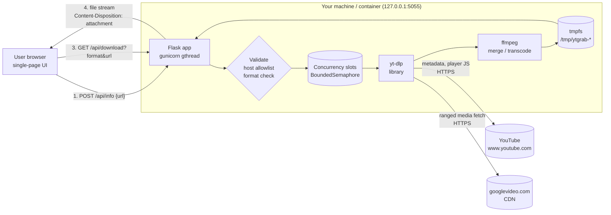
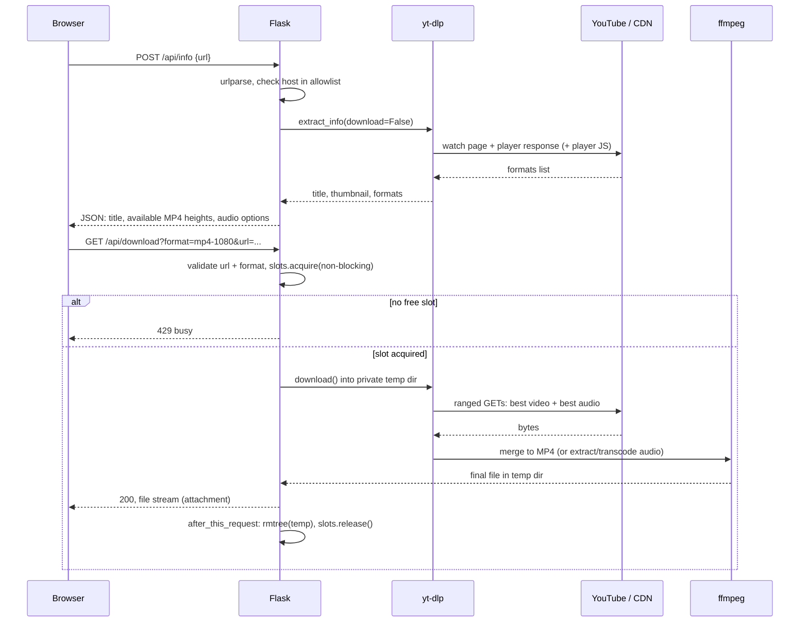
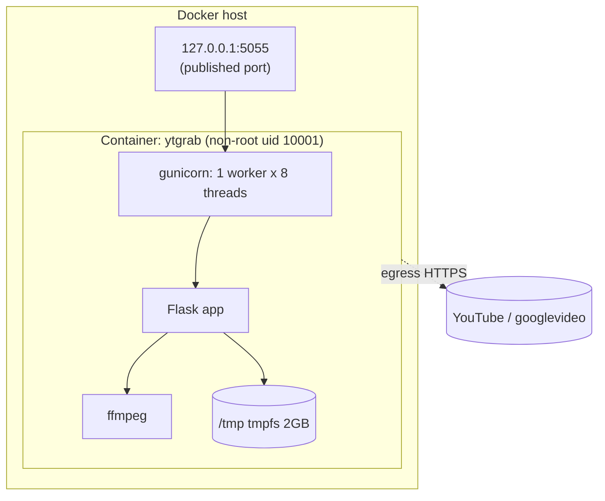
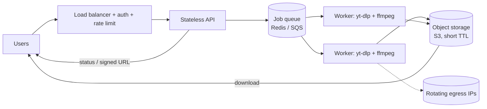

# Architecture

How ytgrab works from the browser down to the bytes, written for engineers and DevOps people who want to know *why* it works and where it hurts at scale.

Contents: [Why downloading is possible](#1-why-downloading-is-possible) · [High-level design](#2-high-level-design-hld) · [Low-level design](#3-low-level-design-lld) · [Deployment](#4-deployment-view) · [Bottlenecks](#5-bottlenecks-and-limits) · [Failure modes](#6-failure-modes) · [Security](#7-security-model) · [Scaling](#8-if-you-had-to-scale-it) · [Decisions](#9-design-decisions)

---

## 1. Why downloading is possible

A YouTube player is just a client that asks Google's servers for media and plays it. The "download" is the same request, minus the player.

1. **The watch page embeds a player response.** When you open a video, YouTube returns JSON (the *player response*) describing every stream available: itag/format id, codec, resolution, bitrate, and a URL on a `googlevideo.com` host.
2. **Streams are separate (DASH/adaptive).** For anything above ~360p, video and audio are **different files**. The player downloads both and syncs them. Low-quality "progressive" formats (video+audio together, up to ~360p) are the exception. This is why a downloader must **merge** streams for HD.
3. **Stream URLs are time-limited and sometimes need proof.** URLs are signed and expire after hours. Some require a computed parameter (historically a cipher "signature" and an `n` throttling challenge, both implemented in the player's JavaScript), and newer clients may require a proof-of-origin token. yt-dlp ports this logic: it fetches the player JS, extracts and runs the transforms, and tries several *client profiles* (web, mobile, TV, etc.) that expose different formats.
4. **The files are downloaded in ranged chunks** over HTTPS (`Range:` requests). YouTube throttles single large connections, so clients fetch in ~10 MB chunks.
5. **Conversion is local.** MP3 is not something YouTube serves. Audio comes as AAC (m4a) or Opus (webm), and ffmpeg *transcodes* it to MP3/WAV.

So ytgrab does not "hack" anything. It performs the same requests a browser does, then does the muxing and transcoding the browser would never need.

**Why this is a moving target.** All of step 3 is an implementation detail Google changes regularly. That is why yt-dlp releases often and why this project tracks it with a weekly Dependabot job. When downloads break, the fix is almost always `pip install -U yt-dlp`.

---

## 2. High-level design (HLD)



### Request flow



### Components

| Component | Responsibility | Why this choice |
| --- | --- | --- |
| Browser UI | Collect link, render options, trigger download | Static page; no framework or build step needed for two screens |
| Flask API | Validation, orchestration, streaming the result | Tiny surface (3 routes); easy to test |
| yt-dlp | All YouTube-specific logic | Best-maintained extractor; reimplementing it is not realistic |
| ffmpeg | Merge DASH streams, transcode audio | Industry standard; yt-dlp shells out to it |
| gunicorn (gthread) | Concurrent request handling | Work is I/O bound; threads are cheap |
| Docker | Pin Python + ffmpeg + deps, sandbox the runtime | "Works on my machine" removed; hardening flags |

---

## 3. Low-level design (LLD)

### 3.1 HTTP API

| Route | Method | Request | Response |
| --- | --- | --- | --- |
| `/` | GET | none | HTML UI |
| `/healthz` | GET | none | `{"status":"ok"}` (used by Docker `HEALTHCHECK` and CI) |
| `/api/info` | POST | JSON `{"url": "..."}` | `200` `{title, channel, duration, thumbnail, video:[{id,label}], audio:[{id,label}]}` or `400` `{error}` |
| `/api/download` | GET | query `url`, `format` | `200` file attachment, `400` `{error}`, `429` `{error}` busy |

Format ids: `mp4-<height>` or `mp4-best`, and `mp3-320`, `mp3-192`, `m4a`, `opus`, `wav`.

### 3.2 Format selection

For video, the yt-dlp selector for a chosen height `H` is:

```
bv*[height<=H]+ba / b[height<=H]
```

Read as: best video-only stream up to `H` **plus** best audio-only stream; if the video has no separate streams, fall back to the best combined stream up to `H`. `merge_output_format="mp4"` makes ffmpeg write an MP4 container (stream copy when codecs are MP4-compatible; otherwise re-encode).

For audio: `bestaudio/best` followed by yt-dlp's `FFmpegExtractAudio` post-processor with the target codec and quality. MP3/WAV are always a transcode. M4A/Opus are usually a stream copy (fast, lossless relative to the source).

The set of heights offered to the user is computed from the real format list, so the UI never offers 4K for a 720p video.

### 3.3 Concurrency control

```
slots = BoundedSemaphore(MAX_CONCURRENT)        # default 2

download():
    if not slots.acquire(blocking=False): return 429
    ...every exit path releases once...
    success path releases in after_this_request (after the bytes are sent)
```

Non-blocking acquire is deliberate: queuing a request behind a multi-minute download would tie up a gunicorn thread and time out the browser. Failing fast with 429 is simpler and honest. The slot is released in `after_this_request`, so it stays held while the file is being sent. Every early-return branch releases explicitly, and a test asserts no slot leaks on a bad format.

### 3.4 Temp-file lifecycle

1. `mkdtemp("ytgrab-")` creates a private directory (mode 0700) under `/tmp`.
2. yt-dlp writes `%(title).150B.%(ext)s` there. `.150B` truncates long titles at the byte level so the filename cannot exceed filesystem limits or contain path separators (yt-dlp sanitises the rest).
3. Flask's `send_file` streams the file from disk in chunks (no full-file memory copy).
4. `after_this_request` deletes the directory and frees the slot. If the client disconnects mid-stream the WSGI server closes the response and the same hook still runs.
5. In Docker, `/tmp` is a size-limited `tmpfs` (2 GB) on a read-only root filesystem, so a runaway download cannot fill the host disk, and nothing persists across restarts.

### 3.5 Frontend

`fetch` calls `/api/info`, renders buttons, then calls `/api/download` and reads the response into a `Blob`, which is saved through a temporary `<a download>`. Simple and works everywhere, with one trade-off: the whole file is buffered **in browser memory** before saving. That is fine for typical videos and a known limit for multi-GB 4K files (see bottlenecks). Switching to a direct navigation (`window.location = downloadUrl`) lets the browser stream to disk but loses inline error display.

---

## 4. Deployment view



Hardening in `docker-compose.yml`: published to loopback only, `read_only: true`, `tmpfs` for `/tmp`, `cap_drop: [ALL]`, `no-new-privileges`, non-root user, `HEALTHCHECK` on `/healthz`, `restart: unless-stopped`.

**Why 1 worker x 8 threads?** The semaphore is in-process memory. With multiple worker *processes* each would have its own counter and the cap would multiply. One process with threads keeps the limit correct. Threads are fine because the time is spent waiting on network and on ffmpeg (a separate process, which sidesteps the GIL).

**Why `--timeout 900`?** gunicorn kills a worker that does not respond within the timeout. A 4K download plus merge can legitimately take several minutes before the first byte is sent.

CI (`.github/workflows/ci.yml`): ruff, pytest, version-consistency check, then build the image and smoke-test `/healthz`, the UI, `ffmpeg` and `yt-dlp` inside the container. Dependabot opens PRs for pip (weekly), Docker base image and Actions (monthly).

---

## 5. Bottlenecks and limits

| Bottleneck | Why it happens | Mitigation / what to do |
| --- | --- | --- |
| **Egress bandwidth** | The server downloads the file from YouTube, then sends it to you. Every byte crosses the link twice. Self-hosted on your own PC the second hop is local, but on a cloud VM you pay both. | Run locally; cap concurrency; if hosted, put it near the users. |
| **YouTube throttling / rate limits** | Per-IP and per-connection speed limits; too many requests from one IP trigger CAPTCHAs, "Sign in to confirm you're not a bot", or HTTP 403/429. Datacenter IPs are hit hardest. | Residential/home IP, low concurrency, backoff, optionally cookies (account risk, see Security). |
| **CPU (transcoding)** | MP3/WAV conversion and non-MP4-compatible merges (VP9/AV1 into MP4) are CPU-bound in ffmpeg. 4K re-encodes are the heaviest operation. | Prefer stream copy (M4A/Opus), cap `MAX_CONCURRENT`, size CPU to concurrency. |
| **Disk (tmpfs)** | The finished file, and during merge the two input streams plus output, exist at once: roughly 2-3x final size. A 4K hour-long video can exceed the 2 GB tmpfs. | Raise the tmpfs size, or limit resolution/duration. |
| **Memory** | Server side is low (files stream from disk). **Browser side** buffers the whole file in a `Blob`. | Navigate directly to the download URL for huge files. |
| **Time to first byte** | The browser sees nothing until download + merge finish, since the file is built before it is sent. Proxies with 60 s idle timeouts (nginx default) will cut this off. | Raise proxy timeouts; or stream progressively / use a job queue with progress (see Scaling). |
| **Worker threads** | A download holds a thread for its whole duration. 8 threads vs. a cap of 2 leaves headroom for `/api/info` and `/healthz`. | Keep `threads > MAX_CONCURRENT`. |
| **Upstream breakage** | YouTube changes the player/API; extraction fails until yt-dlp ships a fix. This is the most common real-world failure. | Weekly Dependabot, easy image rebuild, health checks that exercise yt-dlp. |

---

## 6. Failure modes

| Symptom | Likely cause | Where to look |
| --- | --- | --- |
| `400` with "Sign in to confirm you're not a bot" | IP flagged by YouTube | Run from a home network, reduce rate |
| `400` "Requested format is not available" | Video lacks that height, or client profile lacks it | Pick another format; update yt-dlp |
| `400` signature / `n` challenge / "page needs to be reloaded" | Extractor out of date or transient YouTube error | Retry; `pip install -U yt-dlp` |
| MP3 conversion fails | ffmpeg missing | `ffmpeg -version`; use the Docker image |
| `429` from ytgrab | `MAX_CONCURRENT` reached | Wait or raise the cap |
| Container `unhealthy` | App crashed or port clash | `docker logs ytgrab` |
| Download dies near the end on huge videos | tmpfs full | Increase the `tmpfs` size |

---

## 7. Security model

- **Trust boundary:** the browser is untrusted input. The only inputs are `url` and `format`.
- **SSRF:** `urlparse` + hostname allowlist (YouTube only) prevents using the server to reach internal addresses or arbitrary sites. yt-dlp itself supports hundreds of sites and follows redirects, which is exactly why the allowlist is enforced before it is called.
- **Injection:** yt-dlp is used as a Python library; no shell command is built from user input. `format` is matched against a fixed list, or must be `mp4-<digits>`/`mp4-best` before it is interpolated into the selector string.
- **Auth:** none, by design. It is a personal tool bound to loopback. Do not expose it publicly; if you must, put an authenticating reverse proxy (basic auth/OIDC/Tailscale) in front.
- **Isolation:** non-root, read-only rootfs, no capabilities, tmpfs only for scratch.
- **Supply chain:** pinned ranges, Dependabot, CI builds the image on every change. Review yt-dlp updates since it runs with network access.
- **Cookies:** supporting logged-in downloads means storing session cookies, which is sensitive and risks account action by YouTube. ytgrab intentionally does not include it.

---

## 8. If you had to scale it

This is a single-user tool, but if you wanted a multi-user service the design changes like this:



- Replace the in-process semaphore with a **queue** and a worker pool, so concurrency is enforced globally and workers scale on queue depth.
- Return a **job id** immediately; the UI polls (or uses SSE) for progress, avoiding long-held HTTP requests and proxy timeouts.
- Store results in **object storage** with a short TTL and hand out **signed URLs**, so the API tier never proxies bytes.
- Add **auth, per-user quotas, abuse controls**, and a source-IP strategy, because datacenter IPs get blocked quickly.
- Add **metrics**: queue depth, job duration by format, failure reasons (so upstream breakage is noticed before users report it), and egress cost.
- Legal exposure also grows with a public service (copyright, YouTube ToS); a public hosted version is a different risk profile than a personal tool.

---

## 9. Design decisions

| Decision | Alternative | Why |
| --- | --- | --- |
| yt-dlp as a library | Shell out to the CLI | Typed errors, no shell quoting issues, one process |
| Flask + vanilla JS | React/Next + API | Three routes and one page; a build step would be larger than the app |
| Block (429) when busy | Queue requests | No hung threads or proxy timeouts; simple and predictable |
| Build file, then send | Stream while downloading | Merging needs both inputs complete; simplest correct behaviour |
| 1 worker, many threads | Many workers | Concurrency cap must be process-global |
| Host allowlist | Allow anything yt-dlp supports | SSRF and scope control |
| tmpfs scratch + read-only rootfs | Writable container | Nothing persists, bounded disk use |
| No cookies/auth features | Support private videos | Keeps the tool small and avoids account risk |
